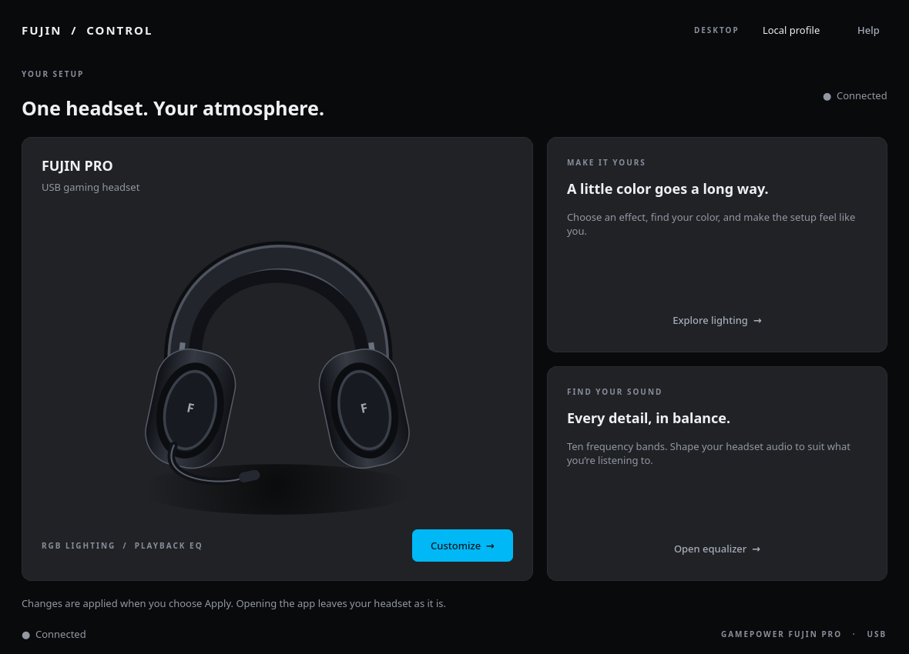
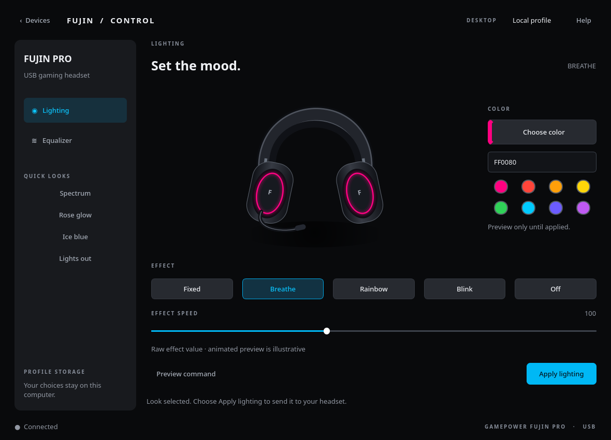
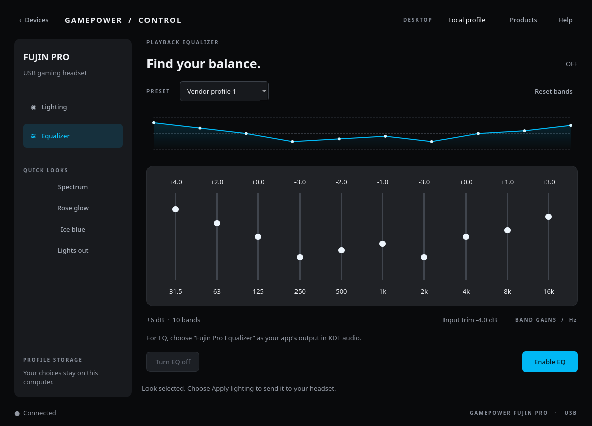

# Fujin Control for Linux

A native Qt6 desktop app and Python CLI for **GamePower Fujin Pro** USB headset lighting, with a ten-band PipeWire playback equalizer.



## Features

- Fixed color, Breathe, Rainbow, Blink and Off, with color picker, hex input, swatches and effect speed.
- Explicit **Apply lighting**: opening the app and changing previews send no lighting reports.
- Ten-band playback EQ, 31.5 Hz–16 kHz, ±6 dB, presets and input headroom attenuation.
- Vendor device catalog: all 53 USB identities/families, with RGB visibility and verification status; read-only detection of connected candidates.
- Strict device discovery for **0600:9c16 / USBFC1S-RGB / HID interface 3**, including exact HID report descriptor validation.
- Lighting dry run, clear errors and scoped device permissions. No hardware-save, firmware, flash, EEPROM or arbitrary-register interface.

This is an independent project, not affiliated with GamePower. The [full vendor catalog](evidence/device-catalog.md) is available in **Device catalog**. RGB and EQ control remain limited to the verified USB variant. The archive's **0600:2616** variant is not supported without separate verification.

## Run the desktop app

Requires Linux, Python 3.10+, PyQt6, PipeWire with filter-chain, `pw-dump`, `pw-link`, and `pactl` for EQ. The lighting CLI requires only Python's standard library. Developed and tested on CachyOS with KDE Plasma 6 on Wayland.

From the cloned repository:

```sh
python3 fujin_app.py
```

Optional: install a per-user application launcher pointing to this checkout:

```sh
python3 tools/install_desktop.py
```

Keep the checkout in place; rerun the installer if it moves. Remove `~/.local/share/applications/fujin-control.desktop` to remove the launcher. No root service or autostart entry is installed.

### Lighting

Select an effect, color and raw speed, then click **Apply lighting**. Nothing is sent while choosing a preview. The animated illustration is illustrative; it does not read the device's current lighting state or represent a measured effect rate. Local choices are kept in `.state/desktop.json` and do not auto-apply at startup.



Off, steady pink/magenta, pink breathe and rainbow have been visually confirmed on the physical headset. Blink is traced from vendor code but has not been visually tested. Hardware persistence is intentionally absent.

### Equalizer

Choose a preset or adjust bands, then click **Enable EQ**. In KDE audio, select **Fujin Pro Equalizer** as the desired application's output if it is not already routed through it. Playback on another processing sink, such as EasyEffects, stays there until you select otherwise. Changed gains require **Apply EQ**.



The vendor configuration selects **software EQ**. Band frequencies, gain limits and Vendor profile 1 were recovered from it; the Linux implementation uses PipeWire peaking filters with Q 1.4. Original Windows DSP coefficients have not been recovered, so this is not a bit-exact DSP clone. Positive gains add input attenuation; this is not a limiter.

EQ runs only while the app is open. It processes playback routed into its virtual sink, sends no USB audio-control commands, and leaves the default output and microphone unchanged. Newly observed Pulse playback streams directly on the headset are moved through the EQ. Turning it off or closing the app restores its playback to the headset and removes its graph. Details: [EQ findings](evidence/eq-findings.md).

Screenshots were captured from a visible Wayland instance of the actual app, without applying lighting or enabling EQ. The headset drawing and app icon are original vector artwork.

## Device permissions

First identify the matching HID node:

```sh
python3 fujin.py devices
```

For ongoing desktop access, the included rule restricts access to the supported headset HID interface:

```sh
sudo install -m 0644 70-fujin.rules /etc/udev/rules.d/70-fujin.rules
sudo udevadm control --reload-rules
```

Reconnect the headset afterward. The `70` prefix places the rule before seat ACL assignment. The rule was checked against observed properties; installing it is an optional system configuration step.

For temporary testing, replace `/dev/hidrawN` below with the exact node shown by `devices`:

```sh
sudo setfacl -m u:(id -un):rw /dev/hidrawN
```

That example uses fish shell syntax. In bash or zsh use `sudo setfacl -m "u:$(id -un):rw" /dev/hidrawN`. Revoke with `sudo setfacl -x u:(id -un) /dev/hidrawN` in fish. Temporary access lasts until the device node is recreated. Do not grant access to all HID devices or run the app as root.

## Lighting CLI

```sh
python3 fujin.py models
python3 fujin.py devices --all
python3 fujin.py devices
python3 fujin.py rainbow --dry-run
python3 fujin.py color ff0080 --mode breathe --dry-run
python3 fujin.py off --dry-run
```

Dry run never opens a device. After granting access:

```sh
python3 fujin.py rainbow
python3 fujin.py color ff0080
python3 fujin.py color ff0080 --mode breathe
python3 fujin.py off
```

`--speed 0..255` sets the raw vendor byte; physical rate and direction have not been measured. Colors are literal wire RGB, bypassing the Windows UI palette remap. `--device /dev/hidrawN` selects among exact matches and cannot bypass identity checks.

## Protocol and validation

- [Lighting protocol](PROTOCOL.md): report framing, I2C bridge, register map, initialization and safety boundaries.
- [Configuration findings](evidence/config-findings.md) and [supplemental LED trace](evidence/config-led-extra.md).
- [Focused instruction evidence](evidence/assembly), [artifact hashes](evidence/artifact-manifest.json), and [validation status](evidence/status.md).
- [Publication audit](PUBLICATION_AUDIT.md): what was excluded before publication.

Run the offline suite without hardware access or an audio session:

```sh
env QT_QPA_PLATFORM=offscreen python3 -m unittest -v
```


The tests cover report framing, safe register bounds, failure cleanup, dry-run isolation, GUI behavior, EQ configuration, device discovery and routing isolation. Live EQ graph lifecycle and physical output links were verified; an audible EQ listening test is not claimed. A completed USB transfer alone does not establish a visible lighting effect.

Original Python code, documentation and artwork are MIT licensed. Vendor-derived instruction excerpts under `evidence/assembly/` retain their original rights; see that directory's notice. Vendor software, firmware, decrypted configuration and downloaded analysis engines are not distributed.
